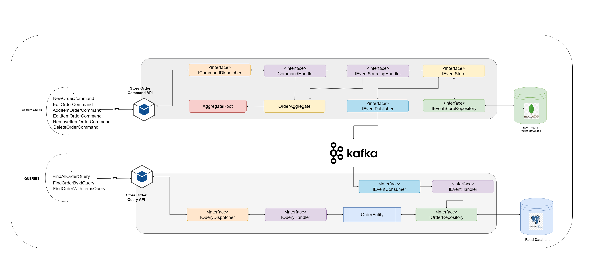

# sales-product-cqrs-event-sourcing-with-kafka

A lab applying the **CQRS** and **Event Sourcing** architectural patterns with **Kafka** and .NET.

## Architecture

## Status / To-do

- [ ] `SaleProduct.Cmd.Infrastructure` — in progress
- [ ] `SaleProduct.Cmd.Domain`
- [ ] `SaleProduct.Cmd.Api`
- [ ] `SaleProduct.Common`
- [ ] `SaleProduct.Query.Infrastructure`
- [ ] `SaleProduct.Query.Domain`
- [ ] `SaleProduct.Query.Api`

## Structure

- **CQRS**
  - **Command**
    - Api: Commands, Controllers
    - Domain: Aggregates
    - Infrastructure: Config, Dispatchers, Handlers, Producers, Repositories, Stores
  - **Query**
    - Api: Controllers, DTOs, Queries
    - Domain: Entities, Repositories
    - Infrastructure: Consumers, Converters, DataAccess, Dispatchers, Handlers, Repositories
  - **Common library**: DTOs, Events
  - **CQRS SDK**
    - Commands: `BaseCommand`
    - Consumers: `IEventConsumer`
    - Domain: `AggregateRoot`, `IEventStoreRepository`
    - Events: `BaseEvent`, `EventModel`
    - Exceptions: `AggregateNotFoundException`, `ConcurrencyException`
    - Handlers: `IEventSourcingHandler`
    - Infrastructure: `ICommandDispatcher`, `IEventStore`, `IQueryDispatcher`
    - Messages: `Message`
    - Producers: `IEventProducer`
    - Queries: `BaseQuery`
